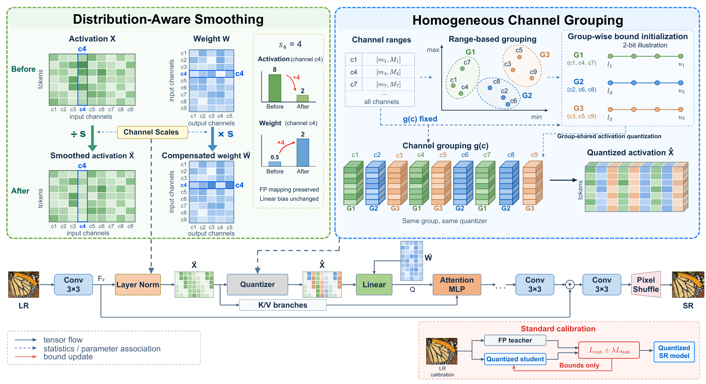

# DHQuant: Smoothing-Guided Channel Grouping Quantization for Super-Resolution Transformers

[[Overview](#overview)] [[Models](#models)] [[Training](#training)] [[Testing](#testing)] [[Results](#results)]

> **Overview:** DHQuant performs post-training quantization of SwinIR-light at 2, 3, and 4 bits. Distribution-Aware Smoothing (DAS) rebalances activation and weight scales through an equivalent transformation. Homogeneous Channel Grouping (HCG) groups channels with similar smoothed activation ranges and assigns shared clipping bounds within each group. A full-precision teacher then guides clipping-bound optimization while backbone weights and group assignments remain fixed.

## Overview

[](docs/figures/overview.png)

*Overall framework of DHQuant.*


**(a)** Channel-wise activation range conditioning by DAS. **(b)** Grouping based on raw versus smoothed activations. DHQuant constructs groups after smoothing and keeps them fixed during calibration.

## Dependencies

- Python 3.8
- PyTorch 1.8.0 and TorchVision 0.9.0
- NVIDIA GPU with CUDA 11.1 for the original reference environment

From the repository root:

```bash
conda create -n dhquant python=3.8
conda activate dhquant
pip install torch==1.8.0+cu111 torchvision==0.9.0+cu111 -f https://download.pytorch.org/whl/torch_stable.html
pip install -r requirements.txt
pip install -e . --no-deps
```

Use a dedicated environment because the project contains its own `basicsr` package. The 0.1.1 fixes also passed CPU checks with Python 3.8.20 and PyTorch 2.4.1+CPU on Windows; the original CUDA setup has not been revalidated. See the [release guide](docs/RELEASE_GUIDE.md) for validation details.

## Contents

- [Overview](#overview)
- [Dependencies](#dependencies)
- [Datasets](#datasets)
- [Models](#models)
- [Training](#training)
- [Testing](#testing)
- [Results](#results)
- [Acknowledgements](#acknowledgements)

## Datasets

| Use | Datasets | Source |
| --- | --- | --- |
| Calibration and bound optimization | DF2K: DIV2K + Flickr2K | [DIV2K](https://data.vision.ee.ethz.ch/cvl/DIV2K/) · [SwinIR data resources](https://github.com/JingyunLiang/SwinIR) |
| Evaluation | Set5, Set14, B100, Urban100, Manga109 | [SwinIR testing instructions](https://github.com/JingyunLiang/SwinIR#testing) |

Set5 is also used for validation during training. Download the datasets separately and arrange them under `datasets/`:

```text
datasets/
├── DF2K/
│   ├── HR/
│   └── LR_bicubic/{X2,X3,X4}/
└── benchmark/{Set5,Set14,B100,Urban100,Manga109}/
    ├── HR/
    └── LR_bicubic/{X2,X3,X4}/
```

Braces denote alternatives. At ×3, an HR image `0001.png` pairs with LR image `0001x3.png`. Adjust `dataroot_gt`, `dataroot_lq`, and `filename_tmpl` in the selected YAML to match your data. Run all commands from the repository root.

## Models

Download the nine DHQuant checkpoints from [Release v0.1.1](https://github.com/liujessica114-ctrl/DHQuant/releases/tag/v0.1.1) or the links below.

| Scale | Precision | Checkpoint filename |
| :---: | :---: | --- |
| ×2 | W2A2 | [DHQuant_SwinIRLight_x2_W2A2.pth](https://github.com/liujessica114-ctrl/DHQuant/releases/download/v0.1.1/DHQuant_SwinIRLight_x2_W2A2.pth) |
| ×2 | W3A3 | [DHQuant_SwinIRLight_x2_W3A3.pth](https://github.com/liujessica114-ctrl/DHQuant/releases/download/v0.1.1/DHQuant_SwinIRLight_x2_W3A3.pth) |
| ×2 | W4A4 | [DHQuant_SwinIRLight_x2_W4A4.pth](https://github.com/liujessica114-ctrl/DHQuant/releases/download/v0.1.1/DHQuant_SwinIRLight_x2_W4A4.pth) |
| ×3 | W2A2 | [DHQuant_SwinIRLight_x3_W2A2.pth](https://github.com/liujessica114-ctrl/DHQuant/releases/download/v0.1.1/DHQuant_SwinIRLight_x3_W2A2.pth) |
| ×3 | W3A3 | [DHQuant_SwinIRLight_x3_W3A3.pth](https://github.com/liujessica114-ctrl/DHQuant/releases/download/v0.1.1/DHQuant_SwinIRLight_x3_W3A3.pth) |
| ×3 | W4A4 | [DHQuant_SwinIRLight_x3_W4A4.pth](https://github.com/liujessica114-ctrl/DHQuant/releases/download/v0.1.1/DHQuant_SwinIRLight_x3_W4A4.pth) |
| ×4 | W2A2 | [DHQuant_SwinIRLight_x4_W2A2.pth](https://github.com/liujessica114-ctrl/DHQuant/releases/download/v0.1.1/DHQuant_SwinIRLight_x4_W2A2.pth) |
| ×4 | W3A3 | [DHQuant_SwinIRLight_x4_W3A3.pth](https://github.com/liujessica114-ctrl/DHQuant/releases/download/v0.1.1/DHQuant_SwinIRLight_x4_W3A3.pth) |
| ×4 | W4A4 | [DHQuant_SwinIRLight_x4_W4A4.pth](https://github.com/liujessica114-ctrl/DHQuant/releases/download/v0.1.1/DHQuant_SwinIRLight_x4_W4A4.pth) |

Place downloaded weights in `release_assets/checkpoints/` to use the testing example below. Weights are downloaded separately from the source code; [SHA256SUMS](https://github.com/liujessica114-ctrl/DHQuant/releases/download/v0.1.1/SHA256SUMS) provides checksums. See the [model zoo](docs/MODEL_ZOO.md) for historical results.

**FP initialization:** for new quantization runs, obtain the DIV2K-trained SwinIR-light models from the [official SwinIR releases](https://github.com/JingyunLiang/SwinIR/releases):

```text
experiments/pretrained_models/SwinIR/
└── 002_lightweightSR_DIV2K_s64w8_SwinIR-S_x{2,3,4}.pth
```

Evaluating a complete DHQuant checkpoint requires only the quantized weight and benchmark images; FP weights and calibration patches are needed for new training.

## Training

Training optimizes the quantizers' clipping bounds with a frozen backbone. The example below uses the supplied **×3, W4A4, and 4,000-update** configuration.

1. Prepare DF2K, Set5 validation images, and the FP SwinIR-light ×3 checkpoint.
2. Collect calibration patches, unless you already have a valid matching file:

   ```bash
   python basicsr/getcalidata.py -opt options/calibration/calibration_x3.yml
   ```

   This saves 32 paired patches to `keydata/cali_data_x3.pth` and refuses to overwrite an existing file. Their LR patches initialize DAS and the quantizers; subsequent bound optimization uses the full DF2K loader.

3. Run training:

   ```bash
   python basicsr/train.py -opt options/train/train_DHQuant_x3.yml --auto_resume --force_yml bit=4
   ```

The YAML supplies the experiment name, 4,000-update budget, batch size 16, and seed 2026. Checkpoints and logs are saved in `experiments/train_DHQuant_x3_bit4/`. `--auto_resume` resumes from the latest saved training state under that name, or starts a new run if none exists. Use a new `name=...` for a separate run. GPU selection is optional and uses `CUDA_VISIBLE_DEVICES`.


## Testing

Prepare the benchmark datasets and the DHQuant checkpoint, then run the following command for x4 W4A4 evaluation.

```bash
python basicsr/test.py -opt options/test/test_DHQuant_x4.yml --force_yml bit=4 path:pretrain_network_Q=release_assets/checkpoints/DHQuant_SwinIRLight_x4_W4A4.pth quant:bound_policy=legacy
```

Results and logs are saved in `results/`.

## Results

### Quantitative results at ×4 (PSNR / SSIM)

Values are from historical evaluation logs; full benchmark verification with the current release code remains pending.

| Precision | Set5 | Set14 | B100 | Urban100 | Manga109 |
| :---: | :---: | :---: | :---: | :---: | :---: |
| W2A2 | 30.2545 / 0.8562 | 27.3296 / 0.7465 | 26.7366 / 0.7039 | 24.2734 / 0.7136 | 27.0578 / 0.8432 |
| W3A3 | 31.3980 / 0.8807 | 28.0893 / 0.7667 | 27.2157 / 0.7221 | 25.2199 / 0.7526 | 29.0108 / 0.8849 |
| W4A4 | 32.0393 / 0.8912 | 28.4450 / 0.7771 | 27.4886 / 0.7323 | 25.9062 / 0.7786 | 30.0235 / 0.9024 |

Values retain the historical log precision. Full ×2 / ×3 / ×4 results and known manuscript/log differences are in the [model zoo](docs/MODEL_ZOO.md).


## Acknowledgements

This project builds on [2DQuant](https://github.com/Kai-Liu001/2DQuant), [BasicSR](https://github.com/XPixelGroup/BasicSR), and [SwinIR](https://github.com/JingyunLiang/SwinIR).
